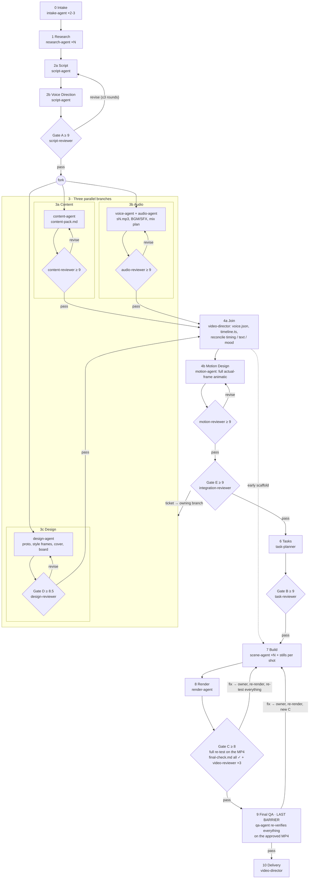

# Canonical skill location

**Edit this file in `.claude/skills/ray-pineline-worflow-agent/SKILL.md` only.**
The `.agents/skills/ray-pineline-worflow-agent` path is a version-controlled
symbolic link back to this folder, so Claude Code, Codex and OpenCode consume
the same workflow, references and review policy without separate copies.
Agent role adapters are generated independently from `.agents/roles/` by
`python3 scripts/sync_agents.py`; run `python3 scripts/sync_agents.py --check`
after editing roles or skill resources.

# Responsibility boundaries (normative)

Read [architecture contract](references/architecture-contract.md) before executing this skill. This file defines **what work is required**, not mutable runtime state or approval logic.

- **Workflow:** this skill defines phases, dependency order and expected artifacts.
- **Transitions:** `scripts/pipeline.py` alone approves stage and gate transitions.
- **Ownership:** agent roles in `.agents/roles/*.md` define who performs each task.
- **Review:** [review-gates.json](schemas/review-gates.json) defines gate thresholds and blocker categories.
- **Execution:** `scripts/runtime_orchestrator.py` records runtime dependencies and bounded retry/resume state, never bypassing pipeline review.

Video source lives in `src/videos/<slug>/`, registered via `src/videos/registry.ts` (not direct `Root.tsx` registration). Existing legacy paths in examples are superseded. Do not self-approve a gate, invent successful checks, clone voices without appropriate permission, or apply retrospective changes to workflow policy without approval.

## Mandatory immediate status synchronization

The monitor is a *reflection of pipeline.py's authoritative status*, not a phase simulator.
Every runtime, including those without subagents, MUST persist each lifecycle event immediately:

1. Before dispatch, call `pipeline.py agent <vid> <role> running --stage <stage>`, then `pipeline.py set <vid> <stage> in_progress` when that stage starts (only once for a shared stage).
2. Immediately after each producer returns, verify artifacts, run `pipeline.py agent <vid> <role> done|failed` and request the legal `set ... done|blocked|failed` transition. For a numbered role, update the exact numbered instance.
3. Immediately after each reviewer returns, write its report, call `pipeline.py review <vid> <gate> <score> --reviewer <role> --report <file> --verdict pass|revise` and call `pipeline.py agent <vid> <reviewer> done`. Then run `pipeline.py gate <vid> <gate>`. A revise is a completed review with a failed *gate*, not a permanently running reviewer.
4. After render returns, persist render stage and agent outcomes immediately, before beginning gate C or QA. An MP4 existing on disk never implies gate C/QA passed.
5. If execution is interrupted, record blocked/failed and HANDOFF rather than retaining misleading running markers. On resumed production check `show` and live runs before marking anything active.

Do NOT batch lifecycle updates until the end of a phase, video, or conversational turn. For monitor-started runs, pipeline.py clears orphan live flags on terminal process exit. A successful review or stage transition also settles matching running records atomically. Monitor must not infer that an agent is running from `stage=in_progress`; only explicit agent activity may mark it running. Poll every second or use an equivalent push mechanism. Never auto-mark a review passed because render completed.

# Video production workflow

This is the **single production workflow** for new and changed videos in this repository. Canonical file: `.agents/skills/ray-pineline-worflow-agent/SKILL.md` (`.claude/skills/ray-pineline-worflow-agent` is a symlink to it; Codex and OpenCode discover it under `.agents/skills/`). `video-director` owns the final result and status. Use `.claude/skills/viral-tech-video-creator/SKILL.md` for research and writing techniques and `.claude/skills/video-shotcraft/SKILL.md` for shot, motion, and sound references. When those resources disagree with this file, follow this file. Read `AGENTS.md` and the selected references before working. The rules in `.agents/rules/` (README first) bind every agent this workflow dispatches and override this file where stricter: include "follow `.agents/rules/`" in every dispatch packet, and run `python3 -I scripts/pipeline.py audit <vid>` after each phase and before ending any turn. Reply in Vietnamese; write code in English.

**Binding for every runtime.** Claude Code, Codex, OpenCode, Cursor, Gemini or any other agent tool runs this workflow as written: every phase 0 → 10, every stage with its evidence, every gate at its threshold, render verification and final QA. A tool without subagents plays the roles in sequence and runs each reviewer in a fresh context that did not produce the artifact. Where this file names Claude Code tools (`Agent`, `subagent_type`, `SendMessage`, `ListAgents`, `TaskStop`, completion notifications), read them as the runtime-neutral operation in **Runtime mapping** below. Light mode and the speed rule change scheduling only. No runtime may skip, merge away or reorder a phase, gate or check, lower a threshold, or accept lower video quality to save time or tokens; a step it cannot perform is `blocked` with the reason, never skipped.

The workflow is **fully automatic**: agents produce, review and approve through the gates themselves, and no step waits for the user to approve by hand. Never end a turn or an agent report with "gửi bạn nghe thử / duyệt giúp / OK chưa"; pick the best option, record the decision in `docs/<vid>/`, and keep going. Ask the user only when a critical input is missing and cannot be inferred safely, or when the user explicitly requested a decision gate. Human listens (audio, final MP4) are optional records, never questions or blockers. Independent reviewers use clean context. Keep verbatim only the user lines the user marked mandatory; everything else may be dramatized or rewritten to serve the story (see the gate-A lesson in Common failure points). Publishing requires a separate user request.

**Light mode.** For a short `story` video, or when the user supplied the script/voice, the director may merge steps without dropping any gate: one `research-agent`, no research file when the user's account is the source, the three Phase 3 branches in one parallel message, and `task-planner` with one `scene-agent` per 3-4 shots. Gates A, D, E, B, C, the content and audio branch reviews, fix-loop discipline and file ownership always stay.

## Pipeline map

After gate A the work forks into **three parallel branches** (content, audio, design), each with its own producer → clean-context reviewer loop. When all three pass, `video-director` joins them (4a), the motion producer and independent reviewer lock actual-frame motion (4b), then gate E reviews the combined plan before build. This is workflow v4; existing v1-v3 videos retain their recorded workflow until explicitly upgraded.

Text fallback: `0 Intake → 1 Research → 2a Script → 2b Voice Direction ⇒ A → fork[ 3a content-agent ⇒ content-reviewer | 3b voice+audio ⇒ audio-reviewer | 3c design-agent ⇒ D ] → 4a Join → 4b Motion ⇒ motion-reviewer → E → 6 Tasks ⇒ B → 7 Build → 8 Render ⇒ C → 9 Final QA → 10 Delivery`. `pipeline.py` enforces the order: `build` cannot be done before E and B pass, and `qa` cannot be done before a verified render, a passed C and every other stage done. Files alone never mark a v3/v4 stage done; only `set <vid> <stage> done` does. Content rules: `design` cites demo TSX only when `skills/video-shotcraft/demos` exists; `build` needs every `src/videos/<vid>/scenes/*.tsx` to show an image, shape, video or motion (not text on a background); `qa` needs at least 3 distinct stills; gate C passes only with a `visual content: X/10` line of 7 or more.

**Changing an existing video** (a fix, re-cut or new version, not a new topic): reopen only the stages the change touches with `pipeline.py set <vid> <stage> in_progress`; the pipeline then invalidates every downstream review, and each invalidated gate is rerun in order with new reviewers. Keep the manifest's composition ID, size, fps and the registry contract in `AGENTS.md`; derive all animation from frames; run `npm run verify` and a visual comparison for visual changes. Media under `public/audio/` and `out/` is not in Git, so a status copied from another machine is re-checked with `pipeline.py show <vid>` first (no `⚠`). A change never skips a gate the original video passed.

**Keep the monitor in sync with this skill.** Any change here to phase numbers or order, stage names, the agent roster, reviewers or gates must be mirrored in the same edit in the roles (`.agents/roles/<name>.md`, then `python3 scripts/sync_agents.py`), in `scripts/monitor.html` (the `PODS` groups and the `seq([...],[...])` phase strip) and, when stages, flow or gates change, in `scripts/pipeline.py` (`STAGES`, `FLOW`, gate maps); then run `python3 -m unittest scripts.test_pipeline scripts.test_monitor_ui scripts.test_sync_agents`. A pod lists its agents before its reviewer, so never group stages from both sides of a gate in one pod (seen 2026-10-18: one "8–9" pod showed `qa-agent → video-reviewer`, as if C came after QA).

## Contract and naming

- A video has a unique lowercase kebab-case topic ID `<vid>`, a voice slug `<voice>`, `docs/<vid>/`, `src/videos/<slug>/`, `public/audio/<vid>/`, and `out/qa/<vid>-*.png`.
- The **only final video** is `out/<vid>-<voice>-reel.mp4`, for example `out/cam-on-phien-ban-minh-anh-khoi-reel.mp4`. The voice slug describes the voice actually heard. When the voice changes, run `python3 -I scripts/pipeline.py voice <vid> <new-voice>` before rendering; the earlier file remains available.
- Start with `python3 -m unittest scripts.test_voice_catalog` to ensure catalog previews resolve. Choose a candidate from `vietnamese-voice-samples/previews/` (the folder is the catalog; filenames are shortened voice names) by catalog description and the user's request, and record the provider and its voice ID in `brief.md`. Voice licence and authorization checks are not part of this workflow (see Voice priority route 2).
- After the Phase 0 duplicate-topic check clears, initialize once: `python3 -I scripts/pipeline.py init <vid> --comp <CompId> --voice <voice> --profile story|product|knowledge|news`. `--voice` is required for new production: pass the best current guess, then run `pipeline.py voice <vid> <slug>` as soon as the route is decided (the slug must name the voice actually heard); `--out` is only for legacy output names. Start or reuse the Pipeline Monitor on port 4180 before dispatching production agents. Do not edit `status.json` manually.
- Around each work stage call `pipeline.py set <vid> <stage> in_progress` and then `done`, `blocked`, or `failed`. Stages are `research, brief, script, content, voice, design, motion, build, audio, render, qa` (`qa` is the final QA after render and C) (`init` creates workflow v4 with `motion`; existing v1-v3 states retain their version until explicit `pipeline.py upgrade <vid>`. Upgrade preserves reports/history, adds pending motion and invalidates E/B/C and QA; never invent a motion approval). The `render` command updates its own stage. Review gates run in order **A → [content · audio · D] → motion → E → B → C**; the two branch reviews are recorded like gates (`review <vid> content|audio …`, `gate <vid> content|audio`, `override` at cap 3) and v4 motion starts after accepted content/audio/D and measured Join inputs; E refuses until motion is accepted and done. Gates A, content, audio, motion, E and B pass at **9/10**, D at 8.5 and C at 8 (`pipeline.py` enforces the score).
- **Agent activity (drives the monitor).** Every time `video-director` dispatches an agent, run `pipeline.py agent <vid> <agent-name> running --stage <stage> --note "<task>"`; when its completion notification arrives, run `pipeline.py agent <vid> <agent-name> done` (or `failed`). Parallel copies use a numbered name (`scene-agent-1`, `research-agent-2`). Without these records the monitor can only guess from stage states, and reviewers never light up. A gate passes only when the score meets the threshold AND no Cao/Trung ticket is open (see Fix-loop discipline); `pipeline.py` cannot see tickets, so the reviewer sets `--verdict revise` while any is open.

| Phase | Stage(s) to set | Gate / checkpoint |
|---|---|---|
| 0 Intake | — (init) | — |
| 1 Research | `research` | — |
| 2a Script + 2b Voice Direction | `brief`, `script` | A |
| 3a Content branch | `content` | review `content` (`content-reviewer`) |
| 3b Audio branch | `voice`, `audio` | review `audio` (`audio-reviewer`, machine verdict) |
| 3c Design branch | `design` | D |
| 4a Join | — (director integration) | — |
| 4b Motion Design | `motion` | review `motion` (`motion-reviewer`, ≥9) |
| 5 Integration | (owning stage reopens on fixes) | E |
| 6 Tasks | `build` → in_progress | B |
| 7 Build | `build`, `audio` (mix integration) | — |
| 8 Render | `render` (automatic) | C (human listen = optional record) |
| 9 QA | `qa` | — |
| 10 Delivery | all stages done (`check`, which also needs `eval.md`) | `eval.md` retro (automatic) + workflow fixes applied + delivery report |

Reopening a stage (`in_progress`/`blocked`/`failed`) invalidates reviews from: research/brief/script → A (and both branch reviews), content → review `content` + E onward, voice → review `audio` + E onward, design → D onward, build/audio/qa/render → C. In v4, changes to content, voice, design, audio cues or measured timeline invalidate motion and E/B/C/QA; motion changes invalidate E/B/C/QA. A new review entry also invalidates everything after it (a branch review re-opens E, B, C). Rerun every invalidated gate in order.
- Different videos can run simultaneously when they use distinct IDs, audio folders, QA prefixes, and outputs. Agents working on one video own disjoint scene files; only `video-director` edits `kit`, `timeline`, `Reel`, `index.ts`, `registry.ts`, and voice JSON. The pipeline serializes writes to one status and one output name.

## Evidence contract: no stage is done, no gate passes, without its files

A stage marked `done` whose files are missing shows **"Lệch file"** in the monitor (`show` prints `⚠ declared done but files missing`); a stage `done` whose guarding gate has not passed prints `⚠ done nhưng gate X chưa đạt`. Both are workflow defects, never something to deliver over. `pipeline.py set <vid> <stage> done` now **refuses** (exit ≠ 0) when the starred evidence below is missing, or when the guarding gate (`script`→A, `content`→content, `design`→D) is neither passed nor overridden. Do not work around a refusal (no hand-editing `status.json`, no placeholder files, no empty `sN.mp3`): produce the missing artifact, then set `done` again.

| Phase | Stage | Must exist before `set done` (* = `pipeline.py` enforces) | Must pass first |
|---|---|---|---|
| 1 Research | `research` | `docs/<vid>/research*.md` * | — |
| 2a Script + 2b Voice Direction | `brief`, `script` | `brief.md` *, `script.md` *, `voice.proposed.json`, `voice-direction.md`, `voice-performance.proposed.json`, `script-review.md` (every round) | A * |
| 3a Content | `content` | `content-pack.md` *, `content-pack-review.md` | review `content` * |
| 3b Audio | `voice` | `voice.json`, `voice-performance.json` + `public/audio/<vid>/<key>.mp3` for **every** key * (`N/N clips`), `voice-report.md`, `voice-clone-asr.md` | — |
| 3b Audio | `audio` | `assets-manifest.md` *, `mix-plan.md`, `bgm*` + SFX files in `public/audio/<vid>/`, `audio-review.md` | review `audio` |
| 3c Design | `design` | `design-spec.md` *, `out/qa/<vid>-style-*.png` ×3, `-cover.png`, `-board.png`, `-motion-hook.png`, `design-review.md` | D * |
| 4a Join | — | `join-notes.md`, measured `voice-durations.ts` and `timeline.ts` | — |
| 4b Motion | `motion` | `motion-spec.md`, `motion-evidence.json`, full animatic and hook/highlight/all-boundary strips *, `motion-review.md` * | review `motion` * |
| 5 Integration | — | `integration-review.md` | E |
| 6 Tasks | — | `task-review.md` | B |
| 7 Build | `build` | composition registered via `src/videos/<vid>/index.ts` *, `voice-durations.ts` from `voice:measure` + `timeline.ts` built on it (no `PROPOSED_FRAMES` left), every scene file in the plan | B |
| 8 Render | `render` | verified `out/<vid>-<voice>-reel.mp4` whose fingerprint = `render_check` * (set by `pipeline.py render` only), `final-check.md`, `render-evidence.md`, `video-review.md` | C (after render) |
| 9 QA | `qa` | `out/qa/<qa-prefix>-*.png` * (≥ 3 per shot + cover), `qa-report.md` with no open Cao/Trung | — |
| 10 Delivery | — | `eval.md` * (`check` refuses without it) | all |

Rules every phase follows:
- **Producer returns evidence paths, director verifies them on disk** (`ls`/Glob plus file size > 0 and, for media, `ffprobe`) before running `set done` or dispatching the reviewer. A reviewer never scores an artifact whose files are incomplete; it returns `revise` with a Cao ticket "evidence missing: <path>".
- **Before every `review`/`gate` call and before Phase 10**, run `python3 -I scripts/pipeline.py show <vid>`: it must print no `⚠` for any stage up to the current one. A `⚠` is fixed first (produce the file, or reopen the stage with `set <vid> <stage> in_progress`, which also invalidates the downstream reviews).
- Unstarred rows are director checks: `pipeline.py` cannot see them, so check them by hand at handoff and list them in the reviewer's dispatch packet.
- **Cold handoff / another machine.** `public/audio/`, `out/` and voice refs are not in Git, so a status copied from another machine can say `done` while the files are absent here (this is how `gaplai`, `metkhong`, `thuong-hay-so-bat-dau-lai` show "Lệch file"). On continuing such a video, first run `show`: for every `⚠` stage either restore the original files (same names, then `verify` for the MP4) or reopen the stage and regenerate. Never mark it done again from memory.

## Agent roster and handoffs

`video-director` is the pipeline owner and information manager: it initializes status, keeps the current brief/script/source decisions as the single source of truth, chooses the profile, assigns files, integrates work, runs gate commands, and delivers the result. Give each specialist the accepted brief, exact inputs, expected output path, and acceptance check. On handoff, `video-director` checks the returned artifact against those inputs, records decisions or unresolved questions in `docs/<vid>/`, updates status, and gives the next specialist only the accepted version. A reviewer must have clean context and must not be the agent that produced the artifact it scores. `video-director` does not score its own work.

**`video-director` is the main conversation thread** (you), not a subagent. It manages every agent below: dispatches, hands over accepted inputs, routes fixes, integrates shared files, records status/gates, and talks to the user. Each phase is run by its own named agent; reviewer agents are separate, clean-context, and new each round.

| Phase | Producer agent | Reviewer agent (gate) | Owns and hands back |
|---|---|---|---|
| 0 Intake | `intake-agent` (read-only) | — | duplicate-topic report, preflight results; the director writes the `brief.md` header; asks the user only when a critical input is missing |
| 1 Research | `research-agent` (× N by source group) | — | `research.md` or `research-<group>.md`: sources, audience language, facts/inferences/unknowns, five hook candidates |
| 2a Script + 2b Voice Direction | `script-agent` | `script-reviewer` (A) | `brief.md`, `script.md`, `voice.proposed.json`, `voice-direction.md`, `voice-performance.proposed.json` / `script-review.md` |
| 3a Content | `content-agent` | `content-reviewer` (branch) | `content-pack.md`: per-shot on-screen text, caption chunks, accent words, cover/re-hook/CTA text, claim→source table, `minh hoạ` labels / `content-pack-review.md` |
| 3b Audio | `voice-agent` + `audio-agent` | `audio-reviewer` (branch, machine verdict) | accepted `voice-performance.json`; `sN.mp3` + durations + ASR (`voice-report.md`); BGM/SFX + beat grid + mix plan + `assets-manifest.md` / `audio-review.md` |
| 3c Design | `design-agent` | `design-reviewer` (D) | `design-spec.md` + prototype + 3 style frames + cover + storyboard + hook motion strip / `design-review.md` |
| 4a Join | `video-director` | — | `voice.json`, `voice-performance.json`, `timeline.ts` draft, `docs/<vid>/join-notes.md` (timing/text/mood/performance reconciliation) |
| 4b Motion | `motion-agent` | `motion-reviewer` (review `motion`) | spec, `motion-proto/`, full animatic, evidence JSON and strips / `motion-review.md` |
| 5 Integration | (fixes go to the owning branch producer) | `integration-reviewer` (E) | `integration-review.md`, judged before full build |
| 6 Tasks | `task-planner` | `task-reviewer` (B) | `task-review.md`: tools, shot→file ownership, dependencies, checks |
| 7 Build | `scene-agent-1..N` (parallel, one file each) | — | `src/videos/<slug>/scenes/*.tsx` + stills; director integrates `timeline`/`kit`/`Reel`/manifest/registry/audio |
| 8 Render | `render-agent` | `video-reviewer` (C, final barrier) | verified MP4 + `final-check.md` (full regression on the MP4) + `render-evidence.md` (contact sheet, dense frames, loudness, ASR) / `video-review.md` |
| 9 QA | `qa-agent` | — | `qa-report.md`: tsc, determinism, frame/transition/caption checks, per-shot design-fidelity score, fixes routed to owners |
| 10 Delivery | `video-director` | — (human listen = optional record) | director writes `docs/<vid>/eval.md` (time/token retro + next-video fixes), applies the workflow fixes, runs `check`, then the delivery report |

Only `video-director` writes shared `kit`, `timeline`, `Reel`, `index.ts`, `registry.ts`, and `voice.json`; specialists propose changes to those files in their handoff. Scene agents read durations from the video's `SHOTS` map and anchor motion to the measured voice span. Never assign two agents the same writable file. If the user stops work, stop background agents too. Gate C is an AI review of contact sheets, dense frames, `ffprobe`/loudness data and ASR; a human listen after C (`pipeline.py listen`) is an optional record, not a delivery blocker.

## Speed rule: dispatch in parallel by default

`video-director` must dispatch as many subagents in parallel as the work allows, so the video is finished as fast and as well as possible. Running steps one after another when they could run together is a defect.

- **Send all independent Agent calls in ONE message** (one tool block), never one per turn.
- **Parallelize whenever inputs are accepted and writable files do not overlap:** `research-agent` × N (one per source group); the three Phase 3 branches (`content-agent`, `voice-agent` + `audio-agent`, `design-agent`) together; `scene-agent` × N (one file and one shot-ID list each); `qa-agent` split by shot cluster; workflow/skill/doc fixes alongside video work; independent fixes routed to different owners in the same round.
- **Independent stages run in parallel (stage map):**
  - Phase 0: `intake-agent` checks (duplicate topic, tool preflight, voice catalog test) in one message; Phase 1: all `research-agent` source groups.
  - Phase 3: all three branch producers in ONE message right after A passes. Each branch then loops producer → its own reviewer independently: a branch that passes waits at the join while the others keep fixing; a branch never waits for another branch's review.
  - Phase 5–6: `task-planner` drafts the plan and `scene-agent`s build the early scaffold while E reviews; B review waits for E pass (plan changes if E changes anything).
  - Phase 7: `scene-agent` × N on disjoint files; Phase 8: contact sheet, dense frames, loudness and ASR evidence computed concurrently; Phase 9 (after C): `qa-agent` per shot cluster plus one on code/determinism, all on the approved MP4.
  - Fix rounds: tickets for different owners go out in one message. Reviews may run concurrently, but the director **records** scores and runs `gate` strictly in order A → D → E → B → C (`pipeline.py` enforces it), and a later reviewer's result is void if an earlier gate reopens.
- **Stay sequential only where a real dependency exists:** gates A → D → motion → E → B → C (a reviewer needs its artifact finished), a fix round that depends on the previous review, and any file with a single owner (`kit`, `timeline`, `Reel`, `index.ts`, `registry.ts`, `voice.json`).
- **Never duplicate running work:** before dispatching, run `python3 -I scripts/pipeline.py show <vid>` and ListAgents, and check the target files' modification times; a stage already `in_progress` with no live agent and no output is stale, so re-dispatch it once.
- **Phase notes:** at the Phase 4a join, `video-director` reconciles content/voice/design timing, text and mood before motion review and E; after gate B, split scenes by explicit shot IDs and disjoint files and run still-frame QA on returned scenes while others continue; research runs in parallel but `script-agent` receives one consolidated handoff; never start a reviewer before its inputs are complete or count a parallel draft as accepted; scale agents to real independent work, not a number.
- **Never skip quality to go faster:** parallelism changes scheduling, not gates, scores, reviewer independence or the file-ownership rules.

### Per-phase fan-out (every phase may run several subagents at once)

Two ways to fan out, both in ONE message: **(1) split producers by independent slice** (source group, shot cluster, asset type, file); **(2) split reviewers by rubric lens**, each a clean-context agent that sweeps the whole artifact through one lens only. Lens reviewers go deeper than one generalist, which raises quality as well as speed. Rules for lens reviewers: each gets the full dispatch packet plus its lens; each writes `<report>.<lens>.md` with full-list tickets (Fix-loop discipline); the director merges them into the gate's single report, de-duplicates tickets, records ONE score = the **lowest lens score**, and any open Cao/Trung ticket from any lens means `revise`. Use at most 3 lenses per gate; a lens with nothing independent to check is not worth an agent.

| Phase | Parallel producers (disjoint outputs) | Parallel lens reviewers / checkers |
|---|---|---|
| 0 Intake | `intake-agent` × 2-3: duplicate-topic scan of `docs/`+`src/`, tool preflight (`ffmpeg`, `ffprobe`, `npx`, deps, `src/videos/registry.ts` IDs), voice catalog test + candidate voices | — |
| 1 Research | `research-agent` × N, one per source group (official docs/README, news/dates, audience language/comments, user's own account); each writes `research-<group>.md`, director consolidates | optional second `research-agent` to fact-check the 3-5 claims that will be on screen |
| 2a Script + 2b Voice Direction | `script-agent` drafts `brief.md`, `script.md`, both voice proposals and `voice-direction.md`; for 2-3 hook/angle candidates run extra `script-agent`s writing `script.alt-<n>.md` and let gate A pick the best (director picks one, deletes the rest from the handoff) | A: `script-reviewer` × 3 by lens: (a) fidelity + sources/claims, (b) hook + specificity/emotional impact + contrast/highlights, (c) spoken naturalness + syllable timing + voice-performance feasibility + visual feasibility |
| 3a Content | `content-agent` (one; split by key range only for > ~12 shots) | `content-reviewer` × 1-2 by lens: (a) caption fidelity + readability + sound-off clarity, (b) claims/sources/labels + user constraints |
| 3b Audio | `voice-agent` (clips split into key ranges when > ~8 shots, e.g. s1-s4 / s5-s8, each its own files) + `audio-agent` (BGM/beat grid and SFX may split) | `audio-reviewer` × 2 (voice clips: ASR/rate/silence/loudness; mix: BGM gap/ducking/SFX collisions/licences) |
| 3c Design | `design-agent` | D: `design-reviewer` × 2-3 by lens: (a) beauty/craft/phone legibility, (b) fit to story + brief + originality vs existing videos, (c) motion quality from the hook strip + design-spec/shot-card validity |
| 4a Join | director only | — |
| 4b Motion | `motion-agent` | `motion-reviewer` ≥9 |
| 5 Integration E | — | E: `integration-reviewer` × 2 by lens: (a) story/text ↔ frames (staging, layout, safe zone, cover), (b) voice durations/holds ↔ pacing + BGM/SFX ↔ story beats |
| 6 Tasks B | `task-planner` (single plan; may run a second planner only to verify tools end to end) | B: `task-reviewer` × 2 by lens: (a) coverage + file ownership + dependencies, (b) tool/asset/font/voice-clip verification by actually running them |
| 7 Build | `scene-agent` × N, 3-4 shots each, one file each, scaffold early (see Phase 7) + a parallel `audio-agent`/director task for `Reel.tsx` mix integration | qa-agent still-frame checks on each returned scene file while others keep building |
| 8 Render C (final barrier) | `render-agent` runs render, then the machine rows of the final regression matrix (`final-check.md`: verify, black/freeze/silence detect, `tsc`, unit tests, determinism md5, `ebur128`, SFX windows, ASR) and the evidence jobs (contact sheet, dense frames, strips) concurrently | C: `video-reviewer` × 3 by lens, all on the final MP4: (a) visual: frames vs `content-pack.md`/design-spec/cover/safe zone/motion strips, (b) audio: ASR vs `voice.json`, cut-offs, mix numbers, SFX, (c) alignment table + story delivered + re-verification of every carried ticket from earlier reports |
| 9 QA | — | `qa-agent` × 2-4 split by shot cluster, plus one on code/determinism (`tsc`, `Date.now`/`Math.random`, safe zone, claims); director routes tickets to owners in one message per owner |
| 10 Delivery | director only (`eval.md` retro + workbench + report); no subagents | — |

- Fan out only when slices are genuinely independent and file ownership stays disjoint; a lens reviewer never edits the artifact; a producer never reviews.
- Each round-2/3 reviewer set is again new clean-context agents, with the same lenses, the previous fix list and closure table.
- Count agents by independent work, not a quota: a 3-shot story needs fewer than a 10-shot product video. When a phase has only one independent slice, run one agent.

## Fix-loop discipline: fail once with the full list, fix once

Goal: fewer rounds. A failed gate must give the producer everything needed to pass on the next try, for every reviewer gate (A, content branch, audio, D, E, B, C, QA).

- **Exhaustive first pass.** The reviewer sweeps the whole rubric before scoring and lists **every** failing item in round 1, not the first few. Stopping at the first problem, or saving issues for later rounds, is a review defect.
- **Fix ticket per item**, in the report's `Fix list`: `id | severity Cao/Trung/Thấp | where (file:line, shot id, frame, timestamp, clip key) | what fails and the evidence | concrete change (rewritten line, new value, replacement asset) | owner agent | acceptance check`. A "make it better" item without a concrete change and a check is invalid.
- **Producer fixes the whole list in one pass,** then self-verifies each ticket by its acceptance check and returns a closure table `id | fixed/not fixed/disagree | evidence`. Disagreeing is allowed, with a reason; silently skipping a ticket is not. The producer is the same agent (SendMessage) so it keeps context; it never starts over.
- **Next reviewer is a new clean-context agent** and receives the previous fix list plus the closure table. It (1) verifies each old ticket by its acceptance check, (2) regression-checks what the fixes touched, (3) raises a **new** ticket only for something genuinely new or newly introduced, and marks it `NEW` with why it was missed. No moving goalposts: an item that passed before cannot fail on taste alone.
- **Pass rule** = overall score >= the gate threshold AND no open Cao/Trung ticket. Open Thấp tickets are carried forward to the next phase's owner, not a reason for another round.
- **Batch, don't ping-pong.** The director merges tickets from parallel reviewers, routes each to its owner in one message per owner, and reruns the review only after all owners reported. Fixes for different owners run in parallel (see Speed rule).
- **Cap (hard, every review/approval gate: A, content branch, audio, D, E, B, C, QA, plan): at most 3 rounds, no round 4–5.** If round 3 still fails, the director **accepts the round-3 version** and moves on, without asking the user: record `pipeline.py override <vid> <gate> --by video-director --note "cap 3 rounds, accepted round 3"`, write the open Cao/Trung/Thấp tickets into the report as `accepted-risk`, and carry them to the next phase's owner (and into the delivery report). Never loop a 4th time. Round 2 (and round 3, if reached) reviewer also states the single root cause behind the repeating tickets, and the producer changes approach (redesign, rewrite, different asset) instead of patching again. Exception: do not override a failure that makes the file unusable (render fails to verify, wrong/missing audio, claim with no source); that is a blocker to fix in a new round-1, not an accepted risk.
- Record every round in the gate's report file (`script-review.md`, `content-pack-review.md`, `audio-review.md`, `design-review.md`, `integration-review.md`, `task-review.md`, `video-review.md`, `qa-report.md`). Branch reviews (content, audio) are recorded with `pipeline.py review <vid> content|audio`; a cap-3 acceptance uses `override` like any gate.

## Runtime mapping (Claude Code · OpenCode · Codex)

Roles have one source: `.agents/roles/<name>.md` (role, tools, model tier, writable files, acceptance check, return format). Never edit the generated copies; edit the role and run `python3 scripts/sync_agents.py` (`--check` in tests). The workflow's operations map to each runtime as follows:

| Workflow operation | Claude Code | OpenCode | Codex |
|---|---|---|---|
| Role definition (generated) | `.claude/agents/<name>.md` | `.opencode/agents/<name>.md` (`mode: subagent`) | `.codex/agents/<name>.toml` |
| Dispatch role `<name>` with the dispatch packet | `Agent` tool, `subagent_type: "<name>"`, background | Task tool with subagent `<name>` (or `@<name>`) | spawn the custom agent `<name>` when the installed Codex supports it; otherwise run a separate `codex exec` process whose prompt is `.agents/roles/<name>.md` + the packet |
| Send fixes back to the same producer | `SendMessage` to that agent | continue the same subagent session when supported; otherwise a new `<name>` subagent given its previous artifact, the full ticket list and its last closure table | same session when supported; otherwise a new process with the same packet |
| Parallel dispatch ("in ONE message") | several `Agent` calls in one message | several Task calls in one turn when supported, else one after another | parallel subagents when enabled (`agents.max_threads`), else one after another |
| See what is running | `ListAgents` + `pipeline.py show <vid>` | `pipeline.py show <vid>` + `pipeline.py agent` records | same as OpenCode |
| Wait for a result | completion notification; never poll with `sleep` | the Task call returns | the subagent or process returns |
| Fresh-context reviewer, every round | new `Agent` call | new Task subagent | new subagent or new `codex exec` process; never the producer's thread |
| Stop everything | `TaskStop` each agent, then `HANDOFF.md` | stop the session, then `HANDOFF.md` | stop the process, then `HANDOFF.md` |

Rows that say "when supported" depend on the installed version: check it, use the fallback when the capability is missing, and say which path ran in the phase report. Every fallback keeps the gate, the threshold and reviewer independence; running one after another is allowed, merging producer and reviewer into one context is not.

## Agent operating model (one independent agent per phase)

- **`video-director` orchestrates, specialists execute.** Every roster agent is defined in `.agents/roles/<name>.md` (role, tools, model, writable files, acceptance check, return format), generated per runtime (see Runtime mapping). Dispatch it with the Agent tool using `subagent_type: "<name>"` (background by default) or the runtime's equivalent; the definition is the standing contract, the prompt carries only the dispatch packet. Subagents cannot spawn subagents, so parallel copies (`research-agent` × N, `scene-agent` × N) are dispatched by the director. `video-director` does not write research, scripts, designs, scenes or reviews itself; it only does Phase 0 decisions, shared-file integration (`kit`, `timeline`, `Reel`, `index.ts`, `registry.ts`, `voice.json` copied from the accepted `voice.proposed.json`), every `pipeline.py` call except `render` (run by `render-agent`), recording reviewer scores, and delivery. Wait for completion notifications; never poll with `sleep`.
- **Dispatch packet** (every agent prompt contains all of it, because the agent starts cold):
  1. Role + goal in one sentence, profile, `<vid>`.
  2. Accepted inputs as file paths (brief, script, research, design-spec, timeline), plus the user's exact constraints quoted.
  3. Writable files (explicit list) and "do not edit any other file".
  4. Acceptance check it must run itself (e.g. `npx tsc --noEmit`, stills at named frames read with Read, ASR table, word count/timing).
  5. Return format: what changed, evidence paths, checks run with results, open issues. Short; no essays.
- **Producer vs reviewer.** A producer owns an artifact through all fix rounds: send review fixes back to the *same* producer with SendMessage so it keeps context. A reviewer is a *new* clean-context agent every round; give it the artifact, rubric, user constraints and the previous round's report (to verify fixes), never the producer's reasoning. A producer never reviews its own work.
- **Review depth.** Reviewers score each rubric item 1-10 with evidence and follow Fix-loop discipline (exhaustive tickets, concrete change, acceptance check); they also state what they could not verify (e.g. audio they cannot hear). A score without evidence is a revise.
- **Stop.** If the user says stop, `TaskStop` every running agent, then write `docs/<vid>/HANDOFF.md` so another agent can continue cold: stage/gate table from `pipeline.py show`, decisions already locked (user's mandatory lines, voice route, palette/metaphor, what must not resemble), files half-edited, ordered next steps with exact commands, and warnings. Report the same summary to the user.

## Phase 0 — Intake and preflight · `intake-agent`

**Owner and handoff:** `video-director` collects user constraints, checks for an existing video on the same topic, then selects `<vid>`, voice and profile, creates `brief.md` and status, and sends the same current input packet to specialists. It alone resolves ambiguous requirements with the user.

**Duplicate-topic check — before creating files, initializing status, or dispatching subagents:** Search `docs/` and `src/` for the proposed topic ID, title, common aliases, and near-equivalent subject matter. Inspect candidate `brief.md`, `script.md`, `research.md`, `status.json`, scene/timeline files, and the composition manifest in `src/videos/registry.ts`; check both the current `docs/<old-vid>/` + `src/<old-vid>/` layout and legacy files directly under `docs/` + `src/`. Do not decide from a filename alone. If a completed or in-progress video covers the same core idea, show the user the matching topic and paths and ask whether to reuse/continue it or make a new version. This is the one allowed question: **pause production until the user answers**; do not silently overwrite, duplicate, or choose a new slug to bypass the question. If the user already explicitly asked to remake that identified video, treat that as the answer, preserve the old files, and use a new version ID/output. If no match is found, proceed and record the check result in `brief.md`.

**Live monitor — after topic clearance and status initialization, before phase 1:** Check `http://127.0.0.1:4180/api/status`. If this repository's monitor is already healthy, reuse it; otherwise run `npm run pipeline` (the package script runs `python3 -I scripts/pipeline.py serve --port 4180`) in a persistent process. Confirm the API includes `<vid>` and give the user `http://127.0.0.1:4180/` so they can watch progress. Keep the monitor available while the workflow runs; do not launch a second server on an occupied port or substitute the old 4179 instance.

Record topic, target audience, platform, duration, profile, source material, user-mandated wording, voice, and output slug in `docs/<vid>/brief.md`. Default 9:16, 1080×1920, 30 fps, **30–45 seconds**, with fast pacing and conversational, emotionally expressive narration (see Phase 2). This duration includes speech, pauses, transitions and the ending hold. An explicit user duration takes precedence; preserve an existing video's duration unless the user requests a change. Check `ffmpeg`, `ffprobe`, `npx`, project dependencies, selected preview, and the existing registry composition IDs. If a critical input is missing, mark the relevant stage blocked and ask one focused question.

## Phase 1 — Research · `research-agent`

**Owner and handoff:** `research-agent` owns `research.md` and may divide independent source searches among subagents. `video-director` consolidates duplicate/conflicting findings, marks what is fact versus inference, and passes one accepted research packet to `script-agent`.

Write `research.md` with source URLs, dated facts, inferences, unknowns, audience questions, and five hook possibilities. For product/technical claims use primary sources. For news verify the event date and current status. For personal stories, preserve the user's supplied account as the primary source and research audience language only where it helps.

## Hook engineering contract — Phase 2a / Gate A
Read [hook-engineering.md](references/hook-engineering.md). `script-agent` produces `docs/<vid>/hook-options.md` with at least three distinct candidate openers, chosen from five research hooks, before locking the script and Phase 2b voice direction. Design 0–1 s visual stop-scroll, 1–3 s truthful curiosity/value promise and a concrete first payoff by ~8 s. The frame-0 cover must work without sound. `script-reviewer` must read the candidates, independently score the first second and first three seconds, and reject unearned clickbait or missing payoff. A passed Gate A still requires overall >=9 and hook sub-score >=9. This creative standard is not an algorithmic guarantee; post-publication analytics, when available, should compare `How many chose to view` and first-three-second retention for comparable videos. Do not claim measured effectiveness from a script-only review.

## Phase 2a — Brief and script · `script-agent`

**Owner and handoff:** `script-agent` drafts `brief.md`, `script.md`, and `voice.proposed.json` from the accepted research and exact user wording, then completes Phase 2b before review. `video-director` checks consistency across these files. A separate `script-reviewer` scores the accepted draft at gate A; `video-director` sends required fixes back to `script-agent`, records the next round, and releases only a passing version to phase 3.

Complete `brief.md`: one viewer need, a retellable point, tone, source/claim plan, visual identity (palette hex, fonts, motion, captions), voice route, and how it differs from earlier videos. Write `script.md` with a shot table: `# | seconds | spoken line | on-screen text | image/action | accent words | delivery | source`. Hook should become clear within 3 seconds, and its on-screen text must make the hook understandable with sound off. Plan a **re-hook** (new question, reveal or twist) at roughly 15–20 s. Describe **frame 0** as the cover: it is the thumbnail on TikTok/Reels/Shorts, so it must already show the hook subject and text, not a blank fade-in. Do not force humor or a sentimental arc on factual work. Count timing in **space-separated syllables**, the repo's unit: about 3.7–4.2 syllables/s (CLAUDE.md's 2.3–2.6 "words"/s means compound words); Thanh Long measures ≈4.1 syllables/s. Show totals in syllables, then revise from measured voice. Local clone voices cannot control pauses, so every deliberate pause or highlight hold is a **split key** (`s6a`/`s6b`, a real gap between two clips) or a `voice-expressive.json` entry; never rely on punctuation alone. Write `voice.json` as the canonical ordered map `{"s1":"spoken text", "s2":"spoken text"}`; every key is one shot. For phrase-level delivery, optionally create `voice-expressive.json` in the same order.

**Default pacing and performance.** Write short, speakable Vietnamese phrases addressed to one person. Keep the edit moving through purposeful action, reveals, emphasis and concise transitions; remove repetition and dead air while leaving time to read captions and register the emotional turn. Fast pacing must preserve natural speech: shorten the script rather than accelerating finished audio to squeeze it into 30–45 s. Budget intentional breaths and the ending hold before estimating the syllable count; measured clips determine the final timeline.

The `delivery` cell for every shot specifies the speaker's intent/emotion, accent words, pace change and breath/pause placement. Aim for a real conversation: varied intonation, meaningful emphasis and emotion that follows the story, rather than a uniform reading cadence. Match the subject (e.g. curious, reassuring, firm, amused); do not force sadness, whispering or exaggerated acting into every line. Example delivery note: `reassuring; stress "vẫn còn"; brisk opening, soften the last phrase; brief breath before the turn`. Keep performance directions out of spoken text and captions.

## Phase 2b — Voice Direction · `script-agent`

This is part of the existing `script` stage and adds no pipeline stage or gate. Before gate A, `script-agent` writes `docs/<vid>/voice-direction.md` and `docs/<vid>/voice-performance.proposed.json`. `voice.json` remains the single canonical spoken-text source. The sidecar describes performance only; concatenating its phrases in order must reproduce each canonical value exactly, with no added, removed or normalized spoken words.

`voice-direction.md` defines the audience addressed, speaker relationship, overall delivery personality, energy curve, emotional turns, restraint and ending behavior. Its per-shot table records intent, emotion, accent words, fast/slow sections, breath and pause placement, and ending contour. Directions are production metadata: they never appear in narration or captions. Gate A checks that the lines are natural to say, the directions are purposeful, and speech plus planned pauses and ending hold fit the 30–45 second default. If the budget fails, shorten and re-review the script; never accelerate finished audio to force a fit.

`voice-performance.proposed.json` is the executable proposal keyed like `voice.proposed.json`. Each shot records the reference candidate, ordered phrases, intent, emotion, emphasis, tempo intent, pauses before/after, seed and only engine controls known to be supported. Experimental cues such as `[cười]`, `[thở dài]` or `[hắng giọng]` stay disabled unless a local benchmark proves that the installed engine produces the intended non-spoken event. Unsupported controls are errors or explicit limitations, never silently ignored.

After gate A passes, `video-director` copies `voice.proposed.json` to `voice.json` and `voice-performance.proposed.json` to `voice-performance.json`, preserving key and phrase order, then dispatches Phase 3. The director owns both accepted files. Any later spoken-text change reopens A; any change to reference, phrase boundaries, pause, seed or accent cue reopens voice/audio review, Join, motion and all downstream gates.

### Gate A · `script-reviewer`

Give a clean-context reviewer the brief, research, script, `voice.proposed.json`, `voice-direction.md`, `voice-performance.proposed.json`, profile rubric, and user's exact constraints. Record every round in `script-review.md`. Score fidelity, hook, clarity, spoken naturalness, timing, source accuracy, visual feasibility and voice-direction feasibility. Check that performance cues are meaningful, excluded from narration/captions, and the full estimated timeline fits the default 30–45 s or explicit duration, including pauses and ending holds. Run `python3 -I scripts/pipeline.py review <vid> A <score> --reviewer <name> --report script-review.md --verdict pass|revise`, then `pipeline.py gate <vid> A`; continue only on exit 0. A pass requires at least **9/10** (the strictest gate; `pipeline.py` enforces it). Gate A scores a separate **specificity / emotional-impact sub-score** (sensory detail per beat, contrast pair, highlights, silence hold, would a viewer be moved or is it flat); pass needs overall >= 9, that sub-score >= 9 and no open Cao/Trung ticket, so constraint compliance alone cannot pass a flat script. Do not wait for the user: after A passes, copy both accepted voice files and dispatch the three Phase 3 branches in one message.

## Profile-specific visual rubric

| Profile | Required hero of each shot | Content test |
|---|---|---|
| `story` | A consistent character acting out the beat, with expressive close-ups where useful | Situation, turn, and ending feel earned; captions support the scene. |
| `product` | The real product, screen, or tangible use case | Show real UI with truthful data and sourced claims; label recreated UI `minh hoạ`. A character is optional. |
| `knowledge` | A concrete example, demonstration, or readable diagram | Each shot adds one accurate idea; sources support claims. A character is optional. |
| `news` | Verifiable image, timeline, map, or cited fact | Dates and uncertainty are clear; do not imply that an illustration is actual footage. |

All profiles require phone legibility, safe text placement above the bottom 210px, intentional composition, consistent palette, readable captions, deterministic animation, and appropriate motion. Style must fit the subject. Reuse motion recipes from video-shotcraft, not another video's palette.

## How this workflow uses video-shotcraft

`skills/video-shotcraft/` (`SC`, vendored, read-only) is the motion, sound and review library for every phase. Project choices that override upstream: autonomous mode (never stop to ask the user to pick a mode), 9:16 re-layout of 16:9 recipes, style from the brief, one BGM render (skip final-review A8), Phase 7 mix targets instead of upstream volume constants.

| Capability | Path in `SC` | Used by |
|---|---|---|
| Whole-video energy arc | `references/sequences/` | script-agent, design-agent |
| 124 shot cards + index + posters/samples | `references/shots/`, `gallery/api/library.json`, `gallery/media/` (browse: `cd SC/gallery && python3 -m http.server 4178`) | design-agent (mapping), design-reviewer, qa-agent |
| Exact tuned demo code | `demos/<category>/*.tsx`, `demos/_fixtures/` | design-agent (prototype), scene-agent (every shot) |
| Reusable components | `assets/lib/` (PageCam, ClipCard, DigitRoll, FlashCut, Caption, FlatPanel, VerticalTicker, helpers) | copied once into `src/videos/<slug>/lib/` by video-director |
| Real page capture (`product`) | `assets/scripts/capture-template.mjs` | design-agent |
| Aesthetic rules R/Q/S/C/P | `references/aesthetic-rules.md` | all producers self-check; design-reviewer, qa-agent, video-reviewer cite rule ids |
| Sound design + SFX library | `references/sound-design.md`, `assets/audio/` | audio-agent |
| Beat grid + `beatF(n)` + back-test | `references/music-beat-sync.md` (librosa in `~/.venvs/vieneu`) | audio-agent, video-director (timeline), render-agent |
| Final independent review | `references/final-review.md` | video-reviewer (gate C) |
| Workbench manifest + editing | `references/workbench.md`, `workbench/` | scene-agent (props), video-director (manifest, delivery) |
| Jianying export / social publish | `references/jianying-export.md`, `references/publish-upload-post.md` | delivery, only on user request |

Every chosen card is validated in `library.json` and recorded with its exact demo path in `design-spec.md`; a shot built without reading its demo TSX is a QA fix. Cards' known-pitfall parameters are never weakened. Score against the selected profile, not a generic character rule.

## Phase 3 — Three parallel branches · content / audio / design

**Owners and handoff:** right after gate A passes, `video-director` dispatches all three branch producers in ONE message, each with the same accepted packet (`brief.md`, `script.md`, `voice.json`, `research*.md`, user constraints). Every branch is a closed loop **producer → new clean-context reviewer → fixes to the same producer (SendMessage) → new reviewer**, capped at 3 rounds. Branches write disjoint files and never wait for each other; a branch that passes waits at the Phase 4a join.

| Branch | Producer (owns) | Reviewer (report, pass bar) | Pipeline |
|---|---|---|---|
| 3a Content | `content-agent` (`content-pack.md`) | `content-reviewer` (`content-pack-review.md`, ≥ 9) | stage `content`, review `content` |
| 3b Audio | `voice-agent` (`public/audio/<vid>/sN.mp3`, `voice-report.md`, ASR) + `audio-agent` (BGM/SFX, beat grid, mix plan, `assets-manifest.md`) | `audio-reviewer` (`audio-review.md`, ≥ 9) | stages `voice`, `audio`, review `audio` |
| 3c Design | `design-agent` (`design-spec.md`, `src/videos/<slug>/proto/`, style frames, cover, storyboard, hook strip) | `design-reviewer` (`design-review.md`, gate D ≥ 8.5) | stage `design`, gate D |

- Branches start from the locked script; nobody in Phase 3 changes a spoken line. A spoken-line problem found in any branch is a ticket for `script-agent`: it reopens gate A, and only the changed keys are re-voiced and re-checked by the other branches.
- Design works from the script's estimated seconds and the draft on-screen text in `script.md`; exact durations and final text are reconciled at the join, not by making design wait.

### 3a Content branch · `content-agent` → `content-reviewer`

`content-agent` locks the **text layer** in `docs/<vid>/content-pack.md`, per `voice.json` key: final on-screen text (≤ 6 words, adds to the line), caption chunks that reproduce the spoken line word for word in phone-readable chunks (≤ 2 lines, ≤ ~28 chars/line), accent words matching the highlight beats, plus **Cover** (frame 0 text + subject), **Re-hook** (~15–20 s), **CTA** (its own shot), a **Claims** table (`id | claim as shown | source URL | fact/inference`) and **Labels** (every recreated UI/diagram marked `minh hoạ`). A new `content-reviewer` checks fidelity to `voice.json`, sound-off clarity, readability, value of on-screen text, emphasis, credibility and user constraints, and appends each round to `content-pack-review.md`. Pass = ≥ 9 and no open Cao/Trung. For a `story` video with no claims the pack is short, but the branch still runs: captions and cover text are what the viewer reads.

### 3b Audio branch · `voice-agent` + `audio-agent` → `audio-reviewer`

**Voice goes first (long pole).** `voice-agent` is dispatched immediately when gate A passes with a strict pass — in parallel with asking the user to approve the script, never waiting for that approval. Gate-A pass means the script is final by definition (any later line change reopens script and invalidates downstream reviews), so generating voice now is safe. This early start applies ONLY on a strict A pass, never on a user-overridden A. If the user later changes a line during approval, regenerate only the changed keys (clips are stored per key `sN.mp3`), never the whole set; a rewrite of half the script or more is the only case for a full regen.

**Perform the lines, not just the text.** `voice-agent` follows each shot's delivery notes and uses the selected engine's supported emotion, style, emphasis, rate and pause controls. Preserve phrasing and intent across clip boundaries. For routes without those controls, choose suitable reference delivery and phrase splits within that route's capabilities, and record limitations in `voice-report.md`; never invent unsupported parameters or insert acting notes into spoken text. Report the intended delivery and the controls actually used per clip. Regenerate targeted phrases when checks or user feedback show a problem. ASR accuracy alone is not evidence of naturalness or emotion, and no machine-only report may claim the voice sounds human.

`voice-performance.json` is the executable sidecar. Synthesize complete meaningful phrases rather than caption chunks, preserving the canonical text exactly. Start with one candidate per phrase; regenerate only a failing phrase or required emphasis, with a hard maximum three candidates per phrase. Keep a native-sample-rate WAV before final encoding. A pinned seed still passes ASR/CER and all audio checks before atomic replacement of the accepted clip. Tempo or pitch post-processing is not the default way to create emotion; use performance references and engine-supported controls. Every requested control must appear under controls actually used or under explicit limitations.

The audio agent selects or creates BGM/SFX, writes the BGM beat grid and a **mix plan** (see Phase 7 targets), and records every source/license in `assets-manifest.md`.

**Audio review (branch reviewer) — no user confirmation.** Audio is created and approved automatically. Dispatch a new clean-context `audio-reviewer` each round (never the voice/audio producer). Score two evidence groups separately: **Technical fidelity** covers ASR/CER against `voice.json`, Vietnamese tones and required terms, duration/rate, silence, raw/final quality, loudness, clipping and cross-clip consistency; **Performance evidence** covers whether planned emphasis, tempo changes, pauses and phrase boundaries in `voice-direction.md` and `voice-performance.json` were actually executed without mechanical speed manipulation. Review the mix separately for BGM-vs-voice gap, ducking, SFX collisions, spectrogram artifacts and licences. It writes `audio-review.md`; pass needs overall >= 9 and no open Cao/Trung; fixes go back to `voice-agent` / `audio-agent`, then a new reviewer. Machine checks cannot prove naturalness or emotion, so label them "not verified by listening" without blocking. The user is never asked to listen; the monitor page `http://127.0.0.1:4180/audition/<vid>` and `pipeline.py audio-listen` stay available as an optional record only, and no gate requires it. Regenerating a clip, changing reference/phrase/pause/accent cues, or changing `bgm*` needs a new `audio-reviewer` round and invalidates Join, motion and downstream gates.

Voice priority:

1. User-supplied complete `public/audio/<vid>/sN.mp3` clips with an identified voice. Do not overwrite them without an explicit replacement request.
2. Local VieNeu-TTS using a purchased preview from `vietnamese-voice-samples/previews/`, selected for the video's subject and delivery profile rather than fixed globally. Keep purchased files read-only and local; never upload them to an external service. Cut a clean 6–8 second, single-speaker, music-free WAV into `docs/<vid>/voice-ref/`. For a new profile, benchmark `Anh-Khoi-Ke-Chuyen`, `Thanh-Long-Nang-Cao`, and `Ngoc-Huyen` with the same original 15–20 second passage containing a question, an informative turn and an emotional close. Make one take per voice, then one additional short emphasis take for the best two: five benchmark samples total. Record the selection evidence; sample metadata alone is not a naturalness ranking. Use installed VieNeu 3.8.3 as the baseline and `voice-performance.json` as the performance input. The generator must reject unsupported controls explicitly, keep raw WAV before encoding, enforce ASR/CER even for pinned seeds, and replace accepted output atomically only after checks pass. Generate full meaningful phrases, initially one candidate each, with targeted regeneration and a maximum three candidates per phrase. No authorization prompt is needed because this catalog was supplied for local use.
3. Otherwise use `python3 -I scripts/gen-voice-expressive.py <vid> --json docs/<vid>/voice.json --voice vi-VN-NamMinhNeural` (or HoaiMy) as a clearly labeled temporary voice.

Use one consistent voice across shots unless the script intentionally has multiple speakers. Run `ffprobe` on every clip, compare ASR to the canonical text, and save measured durations. `voice-agent` checks every clip by machine: ASR against the canonical text (`voice-clone-asr.md`), duration and syllable rate, silence gaps (`silencedetect`), loudness/clipping, and timbre consistency between clips; it regenerates any failing phrase and lists the phrases a human should listen to (accents, tones, slowed lines). ASR checks words but does not prove natural delivery, so naturalness stays on the `audio-reviewer`'s "cannot verify by machine" list and the optional human-listen record. Pin a verified seed where needed, keep the model's watermark, and do not promise a literal 100% human-identical voice. If the selected voice changes, update the output voice slug and timeline before rendering.

### 3c Design branch · `design-agent` → `design-reviewer` (gate D)

The design agent makes a small **style-frame prototype** before full scene implementation (a temporary Remotion composition is preferred so motion can be shown):
- three finished style frames: hook, turn, ending (`out/qa/<vid>-style-*.png`);
- the **cover** = frame 0 of the hook (`out/qa/<vid>-cover.png`);
- a rough **storyboard**, one low-fi frame per shot in a single sheet (`out/qa/<vid>-board.png`), so D and E see every shot, not only three;
- a **hook motion strip**: 2 s of the animated hook at 12 fps tiled into one image (`out/qa/<vid>-motion-hook.png`), so easing, overshoot and pace can be judged.

Record character/UI treatment, palette, fonts/licenses, caption component, reusable props, motion recipe (easing curves, durations, transition types) and shot references in `design-spec.md`.

**Gate D.** An independent `design-reviewer` receives the accepted brief, design prototype, style frames, and selected profile rubric; `video-director` routes fixes to `design-agent` and records gate D. Render and read the three style frames, the cover, the storyboard and the hook motion strip. A clean-context designer reviews them against `brief.md`, profile rubric, originality, consistency, phone legibility, motion quality and visual craft. The review must explicitly answer two questions with frame evidence: (1) is it beautiful — composition, light, color harmony, typography, and finish quality at phone size; (2) does it fit the subject — palette/mood/props match the story's emotion and every frame element serves the beat (seen 2026-10-14: D passed frames whose s7/s8 seating contradicted a remote phone call, caught only at E). A pretty frame that fights the story, or a fitting frame that looks cheap, is a revise in both cases. Record rounds and fixes in `design-review.md`. Run `pipeline.py review <vid> D <score> --reviewer <name> --report design-review.md --verdict pass|revise` and `pipeline.py gate <vid> D`. Full scene build starts after a pass of at least **8.5/10** (`pipeline.py` enforces it). A redo changes the prototype and reruns this gate; the prototype is the deliverable that makes this pre-build gate possible.

**D round cap (hard: 3, same as every gate).** After round 3 the director stops looping and takes the round-3 version: `pipeline.py override <vid> D --by video-director --note <reason>`; remaining tickets transfer to scene owners at build. No user decision needed. Seen 2026-10-16: five D rounds scored 7.6 → 8.1 → 8.6 → 8.8 → 8.8; the last two rounds bought +0.2 then 0 because flat-SVG finish polish, not fixable tickets, was all that remained.

## Phase 4a — Join · `video-director`

Starts only when all three branches passed (or were accepted at cap 3 with `accepted-risk` tickets). `video-director` alone:
- confirms `voice-performance.json` still matches `voice.json` exactly when phrases are concatenated, and reconciles measured phrase/accent/pause cues into Join notes for Motion; unsupported controls remain recorded limitations;
- confirms `voice.json` is still the gate-A text, runs `npm run voice:measure -- <vid> --out src/videos/<slug>/voice-durations.ts` (ffprobe on every clip; it refuses a partial set) and builds the draft `timeline.ts` with `defineVoiceTimeline` from `src/core` over `VOICE_SECONDS` plus intentional `holdFrames`/`leadInFrames` per key, never hand-typed frame counts. Re-run the measure after any clip is regenerated;
- lays the content pack over the storyboard: every on-screen text and caption chunk fits its frame's layout and safe zone, cover text matches `<vid>-cover.png`, highlight beats have holds in the timeline and SFX cues in the mix plan;
- checks the BGM mood/energy arc against the story turn and the hook motion pace against the voice;
- writes `docs/<vid>/join-notes.md`: per key `duration | on-screen text | frame | SFX/beat | mismatch → owner`.

Small mechanical mismatches (a hold length, a cue offset) are fixed by the director in the shared timeline; anything that changes a branch artifact goes back to that branch's producer as a ticket and through that branch's reviewer again. Then dispatch Phase 4b Motion (v4) before gate E. The early scaffold (Phase 7) may start as soon as the draft timeline and prototype exist.

## Phase 4b — Motion Design · `motion-agent` → `motion-reviewer` (workflow v4)

Start only after accepted content/audio/D, `join-notes.md`, measured `voice-durations.ts` and the director's `timeline.ts`. Motion style follows each video's subject and energy curve; retain the default 30–45 s, fast pacing and expressive conversational voice. Design retains art direction, layout and its preliminary hook; motion refines frame timing across the complete video.

`motion-agent` owns `docs/<vid>/motion-spec.md`, `motion-evidence.json`, optional readable `motion-evidence.md`, `src/videos/<slug>/motion-proto/`, `out/qa/<vid>-motion-animatic.mp4` and `out/qa/<vid>-motion-strip-*.png`. Do not edit design's `proto/`, production scenes or shared files. Director registers prototype manifests through `src/videos/registry.ts`, never Root directly. After B, director transfers approved configuration to production; scene owners implement it.

- Spec covers **every shot and boundary, including deliberate cuts**: global/local start/end frames, object/camera path, direction, easing/spring parameters, stagger, voice/beat cue, reading/settle hold, outgoing tail behavior and source/license. Explain fit to this content without forcing one palette or motion personality across videos.
- Produce a full-duration animatic at actual measured voice timing and real-time playback evidence. Inspect hook, highlight, every transition, frame 0 and ending; include a strip even for cut boundaries. Verify continuity of position/scale/direction/speed, attention order, reading time and accent synchronization.
- Read `voice-direction.md` and accepted `voice-performance.json`; use measured phrase, accent and pause cues to place reveals, camera moves, transitions and SFX. Caption timing and text continue to follow canonical `voice.json`.
- Prefer shared official `@remotion/transitions@4.0.534` helpers; adapt individual RVE samples only with source and retained MIT notice in `assets-manifest.md`. Keep video-shotcraft references. Entrance/exit, stagger, pan/zoom and parallax are frame-driven; blur selected visuals while captions remain sharp in a separate layer.
- Voice timing is authoritative: add an outgoing visual tail of `t` frames at the next shot's start, compensate overlap so shot starts and total frames do not move. Audio/captions remain on the original timeline outside transitions. Specify tail continuation/hold without resetting animation or reviving old captions. Reject overlaps longer than either adjacent shot or intersecting another transition.
- `motion-evidence.json` is repo-relative JSON: `fps`, `durationFrames`, `shotStartFrames` (including 0), `animatic`, `hook`, `highlight`, `boundaries: [{frame, strip}]`. Use `out/qa/<vid>-motion-animatic.mp4`, `out/qa/<vid>-motion-strip-hook.png`, `out/qa/<vid>-motion-strip-highlight.png` and `out/qa/<vid>-motion-strip-<frame>.png`. Boundary entries cover each shot start after zero exactly; animatic fps/duration match the timeline and every strip must decode.

Dispatch a new independent reviewer in clean context each round. It writes `motion-review.md` with frame evidence, rubric scores, exhaustive Cao/Trung/Thấp tickets, owners, acceptance checks and closure table; include exact machine line `open high/medium: 0` only when true. Pass requires ≥9/10 and no open Cao/Trung issue. Record `pipeline.py review <vid> motion <score> --reviewer <name> --report motion-review.md --verdict pass|revise`, then `pipeline.py gate <vid> motion`, then `set <vid> motion done`. Use existing three-round cap/blocker rules; do not bypass missing evidence or independent review.

Reopening voice, audio cues, captions, design/storyboard or measured timeline reopens motion and downstream gates. Input fingerprint drift invalidates acceptance: regenerate evidence and get fresh motion review before E; redo Join for timing changes. Existing v1-v3 videos have no mandatory motion stage until explicit upgrade; never silently migrate them.

## Phase 5 — Integration gate E, before full build · `integration-reviewer`

**Owner and handoff:** A new clean-context `integration-reviewer` judges the three joined branches plus accepted motion spec, animatic and review as one planned video. `video-director` routes each ticket to its owning producer (`script-agent`, `content-agent`, `voice-agent`/`audio-agent`, `design-agent`, `motion-agent`) in one message per owner, reruns that branch's own review (content-reviewer / audio-reviewer / gate D, or gate A for a spoken-line change), redoes the join and affected motion review, then dispatches a new E reviewer. It releases an E-approved packet to `task-planner`.

The reviewer reads the **script, content pack, measured voice durations, mix plan, storyboard sheet (`<vid>-board.png`), cover, three style frames, hook motion strip, join notes and accepted motion spec/animatic/evidence/review together**, walking the video second by second. It does not re-score a branch on taste alone; it looks for what only shows when the pieces are combined: frame vs line contradictions (seen 2026-10-14: D passed frames whose s7/s8 seating contradicted a remote phone call), text that does not fit its frame or has no reading time, highlight beats where delivery + visual + SFX do not land together, BGM fighting the turn. For `story`, it also judges emotional specificity, turn, pacing and ending; for `product`, `knowledge` and `news`, clarity, credibility, information order and ending. Record findings in `integration-review.md`, then run `pipeline.py review <vid> E <score> --reviewer <name> --report integration-review.md --verdict pass|revise` and require `pipeline.py gate <vid> E` to pass. If the content itself is weak, rewrite it **now**, before full scene build: return to phase 2, rerun A, re-run the affected branches, join, then rerun E. A pass requires at least **9/10** (`pipeline.py` enforces it).

## Phase 6 — Tool and task gate B · `task-planner` → `task-reviewer`

**Owner and handoff:** `task-planner` turns the E-approved packet into file ownership, shot assignments, tool checks, and integration order. `video-director` confirms no two workers will edit one file, records gate B, and dispatches scene agents only after it passes. Gate B does NOT block early scene scaffolding (see Phase 7) — the planner may dispatch scaffold work as soon as proto + timeline exist.

Write `task-review.md`: selected tools work end to end; each scene has a file owner, inputs, output component, and still-frame check; shared files have one owner. Verify the voice clips, fonts, source assets, and composition naming. An independent planner scores feasibility and coverage. Record with `pipeline.py review <vid> B <score> --reviewer <name> --report task-review.md --verdict pass|revise`; require `pipeline.py gate <vid> B` to pass.

## Phase 7 — Build and audio · `scene-agent-1..N`

**Owners and handoff:** `video-director` owns shared timeline, kit, Reel, manifest and registry, and final audio integration; `scene-agent-N` own assigned shot components in disjoint files. Several scene agents may work in parallel from the B-approved packet. Each returns its component plus still frames; `video-director` integrates them against the measured voice timeline and sends defects back to the owning agent.

**Early scaffold (before E/B pass).** As soon as the design prototype (`src/videos/<slug>/proto/`) and the director's `timeline.ts` exist, scene agents may start building the structural scaffold in their own scene files: staging, layout, and motion mechanics adapted from their card demos — but no final polish, no locked text/captions, no audio sync. The final detail pass runs after the B-approved packet. If E changes staging or the script, the affected scaffold is rebuilt, not patched. Seen 2026-10-16: scenes waited idle through E + task planning although proto + voice durations were already fixed.

`video-director` creates `src/videos/<slug>/timeline.ts` from measured voice duration plus intentional holds (for a beat-synced video also a `beatF(n)` helper from `docs/<vid>/analysis/beat_data.json`; cut/SFX times written in beats), copies the planned `SC/assets/lib/` and `SC/demos/_fixtures/` pieces into `src/videos/<slug>/lib/`, installs npm deps the demos need, then writes `kit.tsx`, `Reel.tsx`, a unique manifest in `src/videos/<slug>/index.ts` registered through `src/videos/registry.ts`, and `src/videos/<slug>/workbench.ts` (tables imported from `timeline.ts`, per `SC/references/workbench.md` §2). Scene agents can implement independent scene files. Headlines, captions and any variable-length on-screen text use `FitText` / `fitFontSize` from `src/core` (`@remotion/layout-utils`) with an explicit `maxWidth`, `maxLines`, `minFontSize` and `maxFontSize` instead of a fixed font size; load the font first (Google Fonts with the `vietnamese` subset), because measuring on a fallback font clips diacritics. Animation must derive from frames; do not use `Date.now()` or `Math.random()`. Anchor spoken-beat animation to the measured voice span, and inspect crossfades at boundaries. SFX/BGM go in `public/audio/<vid>/`; record licenses. Implement `audio-agent`'s mix plan in `Reel.tsx` with frame-based volume callbacks. **Mix targets** (measured on the render, not assumed):
- final integrated loudness −14 LUFS, true peak ≤ −1.5 dBTP (`pipeline.py render` normalizes);
- BGM bed 12–18 dB below voice (short-term LUFS of a voice window vs a music-only hold window);
- BGM ducked a further 4–6 dB while voice speaks, with 150–300 ms ramps; no pumping on short pauses;
- SFX land on a voice accent or a BGM beat (use the beat grid; `skills/video-shotcraft/references/music-beat-sync.md`, `sound-design.md`) and never mask a spoken word.

## Phase 8 — Render, verify, and gate C (final barrier) · `render-agent` → `video-reviewer`

**Owners and handoff:** `render-agent` runs the render, verification, contact sheet, dense frames, loudness and ASR, and returns the evidence. A new clean-context `video-reviewer` scores the current MP4 at gate C from that evidence. `video-director` sends any shot-level defect to its scene/voice/audio owner, re-renders, and obtains a new C review for the new file fingerprint.

**Gate C is the last barrier: nothing reaches the user unless the rendered file itself passes a full re-test.** Earlier gates judged sources (script, clips, frames, code); rendering can still break any of them (audio normalization, mixing, encoding, a late scene fix, timeline drift). So after the render finishes and `pipeline.py render` verifies it, **every earlier check is run again on the final MP4**, not on the source files, and every ticket from earlier reports (including `accepted-risk` and Thấp tickets carried forward) is re-verified on it.

**Final regression matrix** — `render-agent` runs the machine rows and writes `docs/<vid>/final-check.md` (`# | check | origin gate | tool/command | expected | result ✓/✗ | evidence`); the reviewers judge the rest:

| Origin | Re-test on the final MP4 |
|---|---|
| Tech | `pipeline.py verify`: H.264/AAC, 1080×1920, 30 fps, duration in range; file fingerprint = the one under review; no black/flash frames (`blackdetect`), no unplanned freeze or silence (`freezedetect`, `silencedetect` vs the timeline's planned holds) |
| Code / QA | `npx tsc --noEmit` clean; `python3 -m unittest scripts.test_pipeline scripts.test_voice_catalog` pass; determinism: render 3 frames (cover, a mid transition, the ending) twice with `npx remotion still` and compare md5 |
| A · script | ASR of the full mix vs `voice.json` per shot: every word present, none cut off at shot boundaries, order unchanged, mandated user lines verbatim |
| 3a · content | Dense frames read against `content-pack.md`: on-screen text, caption chunks and accent words exact (diacritics included), cover text on frame 0, `minh hoạ` labels and source tags visible, captions above the bottom 210 px |
| 3b · audio | `ebur128`: −14 LUFS ±1, true peak ≤ −1.5 dBTP; voice vs music-only windows 12–18 dB; ducking audible in the numbers; each SFX cue audible and not on a spoken word; closing silence hold present |
| D · design | Frames vs style frames, storyboard and `design-spec.md` (palette, fonts, caption component, cover); motion strips of the hook and each highlight beat not stiff or jerky |
| E · integration | Shot-by-shot alignment table: spoken words, caption, visual action, start–end; re-hook at ~15–20 s; highlight beats land with delivery + visual + SFX together |
| Carried tickets | Every open/`accepted-risk`/Thấp ticket from `script-review`, `content-pack-review`, `audio-review`, `design-review`, `integration-review`, `task-review`, `qa-report`: still acceptable on the final file, or now a fix |

**Rules of the barrier.**
- Run the machine rows and the reviewer lenses in parallel (see the fan-out table); the director merges them into `video-review.md` and records one C score.
- **Pass** = C score ≥ 8 AND every `final-check.md` row ✓ AND no open Cao/Trung ticket.
- **Blockers, never overridden, never `accepted-risk` (not even at round 3):** render/verify failure, wrong/missing/cut-off word, caption or on-screen text ≠ `voice.json`/`content-pack.md`, clipped text or diacritics, text in the bottom 210 px, black/flash frame, true peak > −1 dBTP or voice masked by BGM, an on-screen claim without source or `minh hoạ` label, non-deterministic frames. Any blocker sends the fix to its owner and starts a new round 1 of C.
- **Any fix means re-render, and any re-render means the whole matrix runs again** (not only the changed shot), with new clean-context reviewers, because one change can regress another shot or the mix.
- `video-director` delivers only the file whose fingerprint passed this barrier; Phase 10 `check` confirms it.

Run `python3 -I scripts/pipeline.py render <vid> --min-seconds 30 --max-seconds 45` (use the brief's explicit duration limits for a user override or an existing video). It renders to a temporary path, normalizes audio, checks H.264/AAC 1080×1920 30 fps and duration, then atomically replaces `out/<vid>-<voice>-reel.mp4`. If render/validation fails, the prior file remains and the stage is marked failed. Evidence for the reviewer (in addition to `final-check.md`): frame 0 (cover), 1-fps contact sheet, dense frames (≈6/s) at every transition and the ending, a 12-fps motion strip of the hook and of each highlight beat, loudness/true peak (`ebur128`), voice-window vs music-only-window levels, ASR of the full mix against `voice.json`, and caption text per shot. The reviewer writes a shot-by-shot alignment table in `video-review.md` (spoken words, caption, visual action, start/end, pass/fix) and lists "needs listening" items. Any wrong word, missing/late beat, cut-off speech, mismatched caption, visible glitch, stiff or jerky motion in the strips, weak cover, or level outside the Phase 7 mix targets is a fix. Record with `pipeline.py review <vid> C <score> --reviewer <name> --report video-review.md --verdict pass|revise` (≥8 to pass; add `--full-listen` only if the reviewer really heard the audio). This project delivers **one BGM version**; video-shotcraft final-review item A8 (two versions) does not apply.

**Human listen (after C) — optional record, never a blocker.** `video-director` delivers the C-approved MP4 path plus the "needs listening" list and does not hold the turn open for a reply; never record `listen` on the user's behalf. If the user later confirms they heard the whole file and it is fine, run `python3 -I scripts/pipeline.py listen <vid> --by <user> [--note ...]`; it binds to the current render fingerprint, so any re-render needs a new C review and a new listen. If the user reports a problem, route it to the owning agent and loop back.

## Phase 9 — Final QA, the last barrier (after render and gate C) · `qa-agent`

**When:** only after `pipeline.py render` verified the MP4 and gate C passed on that fingerprint. Before render, Phase 7 still owns per-shot stills and `tsc` on the build; those are build evidence, not QA.

**Owners and handoff:** Independent `qa-agent` (not an author of any scene, not the render-agent or video-reviewer) re-verifies **everything** on the approved MP4 and its sources: re-run every `final-check.md` row itself (do not trust the render-agent's ✓), plus the code, determinism, frame, transition and caption checks below, and every carried ticket. It writes `qa-report.md` with each fix tagged to its owner file. Any fix goes to the owner, then a re-render, a new gate C and a new final QA round. `set <vid> qa done` (refused until render is verified, C passed and every other stage is done) only when no Cao/Trung issue is open.

Run `npx tsc --noEmit`. Render and read at least three stills per shot: beginning, meaningful middle, and boundary; add frames at fast transitions and frame 0 (cover). Fix clipping, diacritics, safe zone, tiny elements, unsupported claims, and caption/voice mismatch. Any `FitText overflow` line in the render or still logs is a Cao ticket for the text's owner (shorten the chunk, add a line, or widen the box), never a smaller `minFontSize`. Score **design fidelity** per shot (built shot vs style frames, storyboard and `design-spec.md`); any shot below 8/10 is a fix for its scene owner. Regenerate stills after each visual change. A clean-context reviewer checks code, determinism, timing, and claims; record findings in `qa-report.md`. Set `qa` done only after fixes and rerun checks.

## Phase 10 — Delivery · `video-director`

**Owner and handoff:** `video-director` collects signed-off artifacts, confirms the final MP4 is the one reviewed at C, runs `check`, writes the per-video eval (`docs/<vid>/eval.md`), and gives the user one delivery report. Specialists do not publish or declare the project complete independently.

Order, all automatic and without asking the user: (1) `show <vid>` prints no `⚠` (Evidence contract); (2) every required stage is `done` (eleven in workflow v4, `content` and `motion` included; follow the stored version for legacy videos); (3) write `eval.md` and apply its workflow fixes (below); (4) run `python3 -I scripts/pipeline.py check <vid>` (it refuses without `eval.md`); (5) send the delivery report. Report the exact output path, duration, voice and licensing basis, review scores per gate, checks run, the optional human-listen record (pending or done), and remaining risks. If gate C finds a content flaw missed by E, return to phase 2 and repeat affected gates; source changes invalidate downstream reviews, while a new render invalidates C. Fix rounds per gate follow the cap in Fix-loop discipline (3 hard); after round 3 the round-3 version is accepted and its open tickets are listed as accepted risks in the delivery report. Do not claim completion if `check` fails for any reason other than the optional listen record; if only that record is pending (it is until the user listens), report the video as "C-approved by AI gates, listen not yet recorded", not as human-verified, and still deliver the path and all evidence without asking for approval. After delivery, open the workbench for this video: point `src/workbench.ts` at it (`export {WORKBENCH} from './<vid>/workbench';`, keeping the previous manifest file in its own folder), run `node skills/video-shotcraft/workbench/scripts/open.mjs .` and give the user http://localhost:5198. Then mention once that a Jianying (CapCut desktop) draft can be exported (`SC/references/jianying-export.md`). Publish to social platforms only on explicit request (`SC/references/publish-upload-post.md`: dry-run first, never rerun on `unknown`).

**Per-video eval — `docs/<vid>/eval.md`, mandatory and automatic before the delivery message.** Every video funds the next one's estimates, so each delivery ends with a short retro written from evidence, not memory. `video-director` writes it as soon as gate C passes, never asks the user whether to run it or which fixes to apply, and never ends the turn between C and the eval. Sections in order:

1. **Scope** — vid, voice route (slug + engine + authorization basis), output path + fingerprint, gate scores.
2. **Where the time went** — table `rank | work item | est. minutes | note`, top 3-5 items plus a total. Reconstruct per-phase wall time from the `status.json` `log[]` `at` timestamps (stage transitions and agent running/done entries) and file mtimes; state environment/tooling debt (setup, broken scripts, retries) separately from production work and give its share in %.
3. **Where the tokens went** — table `rank | sink | why it hurt`. Use the harness usage/cost meter when the session exposes one; otherwise a relative estimate. Sinks are usually: verbose command output, failure/retry loops re-reading the same logs, whole-file reads a `grep` would replace, and wasted searches that proved a negative. Name the top sink explicitly.
4. **What worked well** — reuse-worthy wins (cached model, a one-shot route, a checker that caught something).
5. **Root-cause debt** — the concrete defects that made this video slower or pricier than it should be (script broken on this OS, no standing venv, voice generated too late in the flow, missing clip-vs-shot checker), each with a one-line fix.
6. **Next-video improvements** — imperative instructions the next `video-director` must follow ("run X before Y", "pass flag Z to silence render logs", "generate voice right after gate A"), each with its status `applied <file>` / `ticket HANDOFF.md` / `machine-only`.
7. **Evidence audit** — `show <vid>` output (no `⚠`), plus every `⚠`, `set done` refusal, or missing-file ticket seen during this video and the phase that caused it; each one becomes a row in section 6.
8. **Deliverable verdict** — ship yes/no with the QA evidence behind it, and the accepted imperfections.

**Apply the improvements automatically (self-improving workflow).** Right after writing section 6, the director proposes fixes for review; workflow and enforcement changes require approval:
- a rule or ordering change → propose an edit to this `SKILL.md` (the section that owns the rule, plus a dated "Seen YYYY-MM-DD" line in Common failure points); keep `.agents/roles/<name>.md` consistent when it states the same rule (then run `python3 scripts/sync_agents.py`), and mirror phase/stage/roster/gate changes into `scripts/monitor.html` (see Pipeline map);
- a checker or command bug → fix `scripts/` test-first (add or update `scripts/test_*.py`) and run `python3 -m unittest scripts.test_pipeline scripts.test_voice_catalog scripts.test_monitor_ui scripts.test_sync_agents`; for app code also `npm run verify`;
- a fix that needs the user's machine or credentials (venv, model download, API key) → do not attempt it; mark it `machine-only` and list it in the delivery report.
A fix that would fail tests, or that weakens a gate, score threshold, blocker or reviewer-independence rule, is never auto-applied: record it as a ticket instead. Workflow fixes do not reopen the delivered video's gates; they apply from the next video on. Do not commit or push them unless the user asked; list the changed files in the delivery report.

Eval rules: at most 5 rows per table (rank the rest in one line); every number carries its source (log timestamp, mtime, meter, command output); "be faster" is not an improvement — write the exact command or file change; the eval is linked from the delivery report, not a substitute for it.

## Common failure points

- User default updated 2026-10-18: new videos are 30–45 s with fast pacing and conversational, emotionally expressive narration. Budget pauses and ending holds inside that range; shorten the script instead of speeding up audio. Preserve explicit user durations and existing video timing.

- A stale preview path blocks voice selection: run the catalog test before choosing a voice.
- Rule set 2026-10-17 by the user: voice authorization is not required. Do not check copyright or ask for authorization on voices; focus the audio phase on quality (Voice priority route 2).
- `gen-voice-clone.py` and `gen-voice-expressive.py` read `voice-expressive.json` by default: pass `--json docs/<vid>/voice.json` for plain shot text.
- A review score in prose is not a gate pass: record it with `pipeline.py review` and check its exit status.
- A file's existence is not media verification: use `pipeline.py render` or `verify` and then `check`.
- "Lệch file" in the monitor = a stage declared `done` without its files (seen 2026-10-17: `gaplai`, `metkhong`, `thuong-hay-so-bat-dau-lai`, `cuoc-goi-nho-cua-me` marked voice/qa/render done with 0 clips, 0 stills and no MP4 on this machine). `set done` now refuses this; follow the Evidence contract instead of retrying.
- On Windows run `scripts.test_*` as `python -m unittest ...` without `-I` (isolated mode drops the repo root from the import path); `pipeline.py` itself is fine with `-I`.
- Voice or BGM regenerated after `audio-review.md`: rerun `audio-reviewer`; reopening `voice` or `design` invalidates D, E, B and C.
- A revised render invalidates video review C. Integration review E is done before full build; rerun E whenever any branch artifact changes after it.
- Changing `content-pack.md` after its branch review needs a new `content-reviewer` round: set stage `content` to `in_progress` first, which invalidates the `content` review and E onward.
- Each branch passing alone does not mean the video fits together: never skip the Phase 4a join notes, Phase 4b motion review (v4), or gate E because all three branch reviews passed.
- AI agents cannot hear audio: never claim natural or human-like delivery from ASR alone. Gate C and the audio review pass on measured evidence; the user's `listen` is an optional record.
- A delivery without `docs/<vid>/eval.md` is incomplete: the retro is the feedback loop that keeps every later video cheaper — time from `status.json` `log[]` timestamps, tokens from the harness meter or a relative estimate, never from memory.
- A first script draft can pass gate A and still leave the viewer unmoved (seen 2026-10-14, `cuoc-goi-nho-cua-me`: v1 scored 9.6/10 yet the user ruled it "not moving", forcing a full phase-2 rewrite). Causes found: (1) verbatim-lock treated as fidelity — the draft kept the user's summary wording 1:1, so emotions stayed summarized ("mới nhớ", "rất nhanh") instead of dramatized; (2) no sensory evidence — nothing the viewer can see/hear in their head (v2 fixed it with "phòng tắt đèn / màn hình sáng" and "chưa kịp reo hai tiếng"); (3) one-directional telling with no structural contrast (v2 built symmetric pairs: finger that hung up vs the same finger calling back, cold solo rice vs home feast); (4) climax and CTA crammed in one shot with no silence after the point; (5) every line carried equal weight — no emphasis system. Prevention: in phase 2 require (a) at least one sensory detail per beat, (b) at least one contrast pair carrying the turn, (c) named highlight beats (max 3) each with paired delivery + visual + light, (d) silence/hold after the closing line, (e) a gate-A sub-score for specificity/evidence so constraint-compliance alone cannot pass a flat script.
