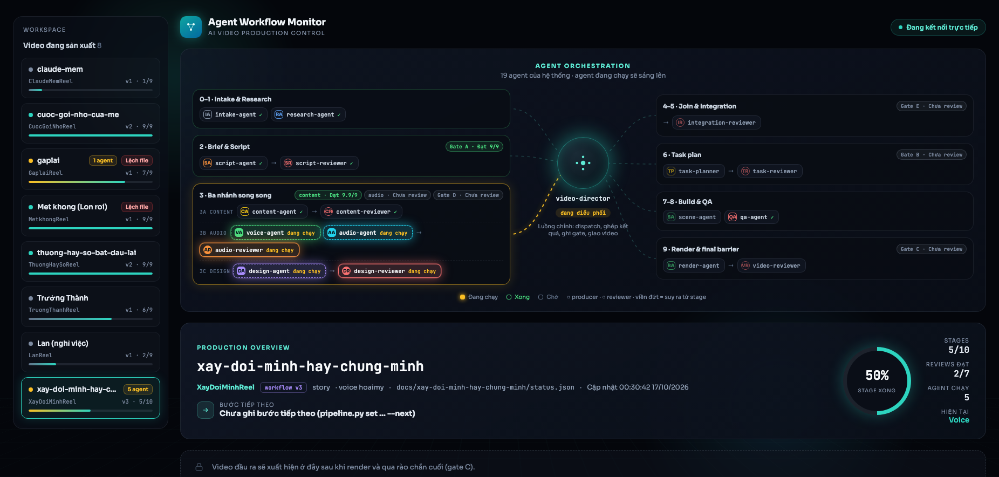
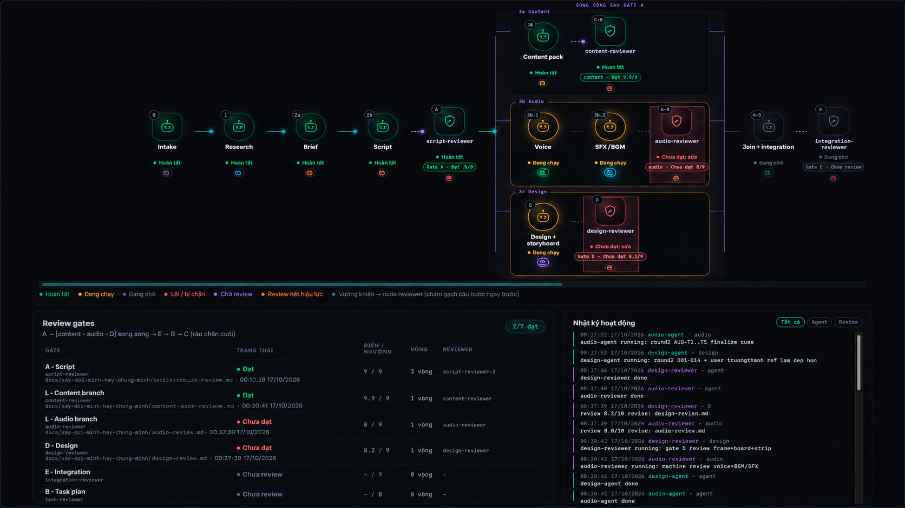
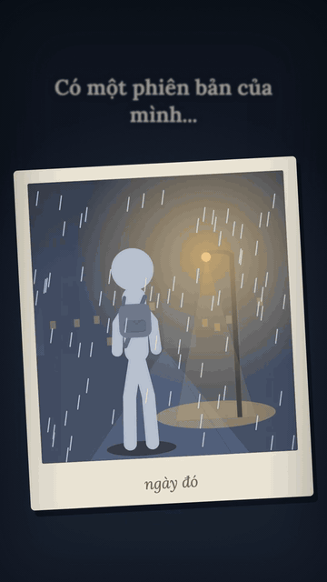

# remotion-ai-agentic-studio

An agent-ready Remotion studio for deterministic 9:16 videos, with parallel research, script, voice, design, scene, QA, and review workflows.



<p align="center"><em>Live production monitor for a 19-agent workflow with parallel branches and independent review gates.</em></p>



<p align="center"><em>The lower monitor view tracks the production pipeline, review scores, and timestamped agent activity.</em></p>

## Try it without an AI API key

A self-contained 5-second, 9:16 animated stick-figure composition ships in the repository. It needs **no TTS provider, model subscription, private media, or API key**.

```bash
npm ci
npm run render -- --id HelloWorldReel --out out/hello-world.mp4
```

To inspect or change the scene, run `npm run studio` and select `HelloWorldReel`. Source: [hello-world template](src/videos/hello-world/). It uses only Remotion, React, SVG and frame-derived animation.

The sample validates the rendering path, **not** autonomous 19-agent production. To use external voice generation or production agents, configure the relevant providers separately.

## Starter template gallery

Explore the [two reproducible, zero-key video templates](docs/template-gallery.md): **Stick Figure Story** and **Editorial Quote**. Preview both in Remotion Studio or download their rendered MP4s and GIFs from the GitHub Actions `zero-key-demo-showcase` artifact once the `demo-smoke` job succeeds. These are starter compositions, not autonomous AI-generated videos.

```bash
npm run render -- --id EditorialQuoteReel --out out/editorial-quote.mp4
# Generate both MP4 and GIF showcase files (requires FFmpeg):
node scripts/render-demo-showcase.mjs
```

## Demo video

[](https://github.com/nanxnguyen/remotion-ai-agentic-studio/releases/download/demo-v1/camon-reel.mp4)

[▶ Watch or download Camon Reel — 52.9 seconds, MP4](https://github.com/nanxnguyen/remotion-ai-agentic-studio/releases/download/demo-v1/camon-reel.mp4)

Rendered videos are published as GitHub Release assets so the repository history stays lightweight.

## Local Vietnamese voice previews 🎙️

Voice previews are **local-only** and are not distributed in this repository. If you maintain a personal voice catalog, keep its MP3 samples under `vietnamese-voice-samples/previews/`; Git ignores that directory. Select a provider and voice ID in each video's `brief.md`, then generate narration using a service for which you have the appropriate rights. Run `python3 -m unittest scripts.test_voice_catalog` to validate any locally installed previews.

## Why this repository

- Build vertical videos with React, TypeScript, and Remotion 4.
- Give Codex, Claude Code, Gemini CLI, and Cursor one canonical instruction source.
- Keep composition metadata, timelines, audio tracks, and test frames typed and discoverable.
- Scaffold a registered video module in one command.
- Protect visual identity with golden-frame comparison and independent review gates.

## Quick start

Requirements: Node.js 22, npm, Python 3.12+, FFmpeg, and FFprobe.

```bash
git clone https://github.com/nanxnguyen/remotion-ai-agentic-studio.git
cd remotion-ai-agentic-studio
npm install
npm run studio
```

Open the 19-agent production monitor in another terminal:

```bash
npm run pipeline
```

Then visit <http://127.0.0.1:4180/>.

## Render any video / environment checks

Run the environment diagnostic before production:

```bash
npm run video:doctor
```

Render a registered composition without editing `package.json`:

```bash
npm run render -- --list
```

`npm run render` still renders the previous default composition (`UnderstandAnythingReel`) for backward compatibility. Existing assets referenced by some compositions are external; follow `public/.external-assets.json` if a render reports missing media.

**Note:** `npm run pipeline` starts the production **monitor**, not an autonomous AI runner. Producing new AI-generated scenes requires an agent runtime and following `AGENTS.md` and the applicable skill.

## Create a video

```bash
npm run video:new -- --slug product-story --id ProductStoryReel --scenes 8
```

The command validates input, creates `timeline.ts`, `Reel.tsx`, numbered scene files and a manifest, then adds it to the shared registry. Customize the generated module and run `npm run verify`.

## Architecture

```text
src/
├── core/                 typed video, timeline and audio contracts
├── videos/
│   ├── registry.ts       only composition catalog
│   └── <slug>/           manifest, Reel, timeline, scenes and theme
└── Root.tsx              renders the registry
scripts/
├── pipeline.py           evidence, review gates, render checks and monitor
└── video-new.mjs         transactional video scaffolder
.agents/skills/           portable agent workflows (canonical)
.agents/roles/            runtime-neutral agent roles (source of truth)
.claude/ .opencode/ .codex/  generated or symlinked runtime adapters
tests/golden/             three reference frames for each shipped composition
```

The seven existing video manifests preserve their original composition IDs, durations, dimensions, imagery, and audio. Some manifests temporarily wrap legacy implementation files; these can migrate video-by-video without changing the public contract or visual baseline.

## Agent matrix

| Layer             | Canonical entry point                      | Purpose                                      |
| ----------------- | ------------------------------------------ | -------------------------------------------- |
| All agents        | `AGENTS.md`                                | architecture, safety, verification, language |
| Portable workflow | `.agents/skills/ray-pineline-worflow-agent/SKILL.md` | phases, stages, gates, runtime mapping |
| Agent roles       | `.agents/roles/*.md` → `python3 scripts/sync_agents.py` | one source for every runtime's subagents |
| Claude Code       | `CLAUDE.md`, `.claude/agents/` (generated), `.claude/skills/` (symlink) | thin adapter |
| OpenCode          | `.opencode/agents/` (generated + hand-written `video-director`) | thin adapter |
| Codex             | `AGENTS.md`, `.codex/agents/*.toml` (generated) | thin adapter |
| Gemini CLI        | `GEMINI.md`                                | thin adapter                                 |
| Cursor            | `.cursor/rules/agent-guide.mdc`            | thin always-on adapter                       |

## Verification

```bash
npm run verify       # lint, format check, TypeScript, Vitest, 34 Python tests
npm run test:visual  # render and compare the 21 golden frames
```

Pull requests run lightweight verification. Full MP4 rendering is opt-in through the manual GitHub Actions workflow or a release process.

## Assets and releases

Source media must have explicit redistribution rights and attribution. Personal voice catalogs, local skill galleries, caches, and final MP4 files are ignored. Publish large finished videos as GitHub Release assets instead of adding them to repository history.

Intentionally private or generated runtime files are documented in `public/.external-assets.json`; recreate them from each video's voice manifest when rendering the original productions.

See [Contributing](CONTRIBUTING.md), [Security](SECURITY.md), [good first issues](docs/good-first-issues.md), and the [audio attribution record](docs/audio-attribution.md).

## License

Code is released under the [MIT License](LICENSE). Media assets may have separate terms documented in their manifests.
